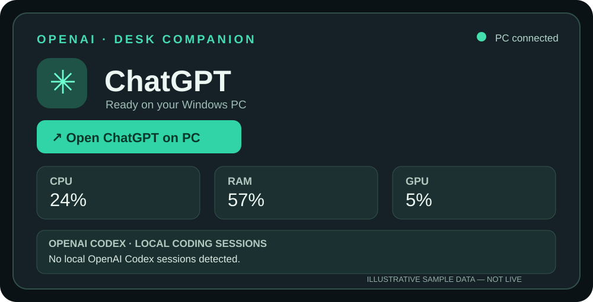

# PhoneBox ChatGPT Companion — Mini Project

**An unofficial ChatGPT-themed dashboard add-on for [PhoneBox](https://github.com/ersinkoc/phonebox).** It turns an old Android phone (such as a Samsung Galaxy J5 Prime) into a companion display for a Windows PC. The add-on changes the **AI Sessions tile**, not the PhoneBox app itself.

> **Status:** Prototype. Static browser preview and automated structural tests are available. The full installer and Android/Windows integration still need to be tested on a real PhoneBox 0.9.22 installation before calling this production-ready.
>
> **Not affiliated with or endorsed by OpenAI, ChatGPT or the PhoneBox author.** The original PhoneBox app must be installed separately.



*Preview uses sample values. Live values only appear when supplied by PhoneBox.*

## About this mini project

The project explores repurposing an old Android smartphone as a **USB-connected desktop dashboard and controller**. It adds a custom HTML/CSS/JavaScript companion card to the existing open-source PhoneBox project. It was developed as an independent **extension**, with AI-assisted code generation, rather than a fork or complete rebuild of the PhoneBox Windows agent and Android APK.

### Features

- ChatGPT-branded companion panel to replace one existing `AI sessions` widget.
- One-tap **Open ChatGPT on PC** action using a preconfigured PhoneBox shortcut.
- CPU, RAM and GPU indicator slots (only render supported, actual data).
- Local **OpenAI Codex** coding-session status when supplied by PhoneBox.
- Neutral empty states when the PC doesn't provide data.
- Dark, touch-friendly HTML/CSS layout suitable for a spare Android phone.
- Targeted Windows PowerShell installer with `-WhatIf`, explicit confirmation and configuration backup.
- Keeps existing PhoneBox pages and independent GitHub widget unchanged.

### What it does NOT do

- It does **not** read ChatGPT web conversations, ChatGPT Plus subscription limits, private browser tabs or ChatGPT login cookies.
- It does **not** provide a chat interface to the ChatGPT service or require OpenAI API keys.
- **Codex coding sessions are not ChatGPT web chat sessions.**
- It does **not** install or fork the official PhoneBox Android APK.

## Requirements

- Windows 10/11 PC with **PhoneBox 0.9.22** already installed.
- Old Android phone running the PhoneBox app (USB recommended).
- USB data cable, USB debugging enabled and PC approved on the phone.
- PowerShell and Python 3 (Python only for tests).
- Original PhoneBox docs: [Setup](https://github.com/ersinkoc/phonebox/blob/main/docs/SETUP.md).

## Installation

1. Download this repository as a ZIP (`Code` → `Download ZIP`) or clone it.
2. Install PhoneBox from its official repository, and connect the Android phone.
3. Open <http://127.0.0.1:8765> in the Windows PC browser, go to **Pages → Sessions** and **Save** once. This converts the initial template into actual page widgets.
4. **Review** [`Install-ChatGPTWidget.ps1`](Install-ChatGPTWidget.ps1) before running it. Open PowerShell in this folder.
5. Preview the change without writing files:

   ```powershell
   .\Install-ChatGPTWidget.ps1 -WhatIf
   ```

6. To apply:

   ```powershell
   .\Install-ChatGPTWidget.ps1
   ```

7. Type **YES** to confirm. The installer backs up `%APPDATA%\PhoneBox\config.json` before making any changes.
8. Refresh the PhoneBox settings, select **Pages → Sessions → Save**, and click **Open on phone**. If PhoneBox overwrites the changed file from memory, **exit PhoneBox**, rerun the installer and relaunch it.

A **manual/no-script installation** is also possible: use **Shortcuts** to create a URL shortcut with ID `chatgpt-open` and target `https://chatgpt.com/`, then replace the AI Sessions tile with a **Web & data → Custom HTML** widget using the contents of [`phonebox-chatgpt-widget.html`](phonebox-chatgpt-widget.html).

## Project architecture

```text
Android phone (PhoneBox app)
       │  USB / authenticated Wi-Fi
       ▼
PhoneBox Windows Agent (existing project)
       │  sandboxed widget data/events and shortcut ID
       ▼
Custom HTML / CSS / JavaScript widget (this repo)
       ├── PC stats (when exposed by PhoneBox)
       ├── local Codex activity (when exposed)
       └── chatgpt-open shortcut → browser opens chatgpt.com
```

The HTML widget is isolated in PhoneBox's sandbox. It sends only the trusted shortcut **ID**, not an arbitrary shell command. The URL is configured locally in PhoneBox's shortcut settings.

## Files

| File | Purpose |
|---|---|
| `phonebox-chatgpt-widget.html` | UI and widget event handlers |
| `Install-ChatGPTWidget.ps1` | Safe, targeted Windows configuration modifier |
| `preview.html` | Local browser demo with mocked values |
| `Publish-To-GitHub.ps1` | Optional guided public-repository publisher |
| `assets/dashboard-preview.svg` | Sample screenshot for the README |
| `tests/verify.py` | Offline structure checks |
| `tests/widget.test.cjs` | UI event/shortcut tests using Node.js mocks |
| `docs/MINI_PROJECT_REPORT.md` | Abstract, objectives, architecture and scope |
| `PUBLISH.md` | GitHub publishing guide |

## Verification

```bash
python tests/verify.py
node --test tests/widget.test.cjs
```

Open `preview.html` in a browser to see a **demo**, not live phone data. The automated tests cannot guarantee compatibility with a physical Android device. The installer hasn't been executed against the user's personal Windows configuration here.

## Restore

1. **Exit** the PhoneBox Windows agent.
2. Find `%APPDATA%\PhoneBox\config.json.chatgpt-backup-*.json`.
3. Restore the desired backup to `%APPDATA%\PhoneBox\config.json`.
4. Restart PhoneBox. Note: restoring the backup also reverts any PhoneBox settings edited after that backup.

## Credits, licensing and disclosure

- Original project: [PhoneBox by Ersin KOÇ](https://github.com/ersinkoc/phonebox), MIT licensed.
- This independent add-on is MIT licensed; see [`LICENSE`](LICENSE).
- The HTML widget, installer and documentation were prepared with AI coding assistance and should be reviewed and tested before a public release.
- **No token extraction, ChatGPT credential collection, analytics or API key storage.** Never commit your local `config.json`, personal GitHub tokens or phone pairing secrets.

For publishing instructions see [PUBLISH.md](PUBLISH.md); optionally run `./Publish-To-GitHub.ps1` in PowerShell after reviewing the source, configuring Git name/email and confirming you want a **public** repository.

For a school/college submission, see [Mini Project Report](docs/MINI_PROJECT_REPORT.md).
